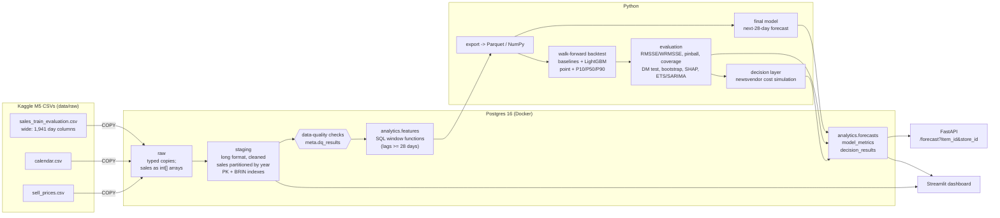

# ShelfWise

**Retail demand forecasting and inventory decisions on the Walmart M5 dataset.**

ShelfWise forecasts daily unit sales 28 days ahead for every product in every store
(30,490 item-store series, ~59M rows in long format), turns the forecasts into order
quantities with a newsvendor rule, and measures how much cost that saves compared with
naive ordering.

It is built as an end-to-end analytics system: a layered Postgres warehouse with SQL
feature engineering, data-quality checks, incremental loading, walk-forward
backtesting with significance tests, a decision layer, and a REST API plus a dashboard.

> **Status:** code complete; results pending. Every number in the Results section is a
> placeholder until it is filled in from real pipeline output. No result in this README
> is estimated or invented.

---

## Contents
- [Architecture](#architecture)
- [Repository layout](#repository-layout)
- [Setup and running](#setup-and-running)
- [Method in brief](#method-in-brief)
- [Results](#results)
- [Limitations](#limitations)
- [What I'd do next](#what-id-do-next)
- [Troubleshooting](#troubleshooting)

Detailed methodology, including design choices and the leakage argument: [docs/methodology.md](docs/methodology.md).

---

## Architecture



**Incremental by design.** Watermarks in `meta.watermarks` record how far each layer has
been built. A new batch of days is appended to staging, and only the affected feature
rows are recomputed, re-reading a fixed look-back buffer. A unit test checks that an
incremental build gives exactly the same rows as a full rebuild.

---

## Repository layout

```
├── config/config.yaml          methodology settings (windows, model params, cost assumptions)
├── .env.example                DB credentials, SUBSET, LAST_DAY (copy to .env)
├── docker-compose.yml          Postgres 16, tuned for a laptop analytics workload
├── Makefile                    every command (`make help`)
├── sql/
│   ├── ddl/                    schemas: raw, staging (partitioned), analytics, meta
│   ├── staging/                wide->long reshape (unnest WITH ORDINALITY), cleaning, indexes
│   └── analytics/features_select.sql   all feature engineering (window functions)
├── src/shelfwise/
│   ├── ingest/                 CSV -> raw (COPY, file fingerprinting)
│   ├── transform/              staging, features (incremental), export to Parquet
│   ├── quality/                data-quality checks + report
│   ├── forecasting/            folds, baselines, LightGBM, backtest, final forecast
│   ├── evaluation/             metrics, significance tests, error analysis, SHAP, ETS/SARIMA
│   ├── decision/               newsvendor rule + cost simulation
│   ├── serving/                FastAPI app, Streamlit dashboard, shared queries
│   ├── benchmark/              EXPLAIN ANALYZE before/after benchmark
│   └── pipeline/run.py         single entry point
├── tests/                      leakage (DuckDB), folds, ordering rule, metrics, DB integration
├── docs/methodology.md
└── reports/                    generated: results, figures, data-quality, benchmarks
```

---

## Setup and running

### Prerequisites
- Docker Desktop
- Python 3.11 or 3.12. Python 3.13 may work, but LightGBM and SHAP wheels are most reliable on 3.11/3.12.
- macOS only: `brew install libomp` (LightGBM needs OpenMP)
- About 10 GB free disk for the full dataset (Postgres plus caches); 16 GB RAM recommended for the full run

### Get the data (not committed)
Accept the competition rules on Kaggle, then download the files:
```bash
pip install kaggle
```
```bash
kaggle competitions download -c m5-forecasting-accuracy -p data/raw
```
```bash
unzip data/raw/m5-forecasting-accuracy.zip -d data/raw
```
You need `sales_train_evaluation.csv`, `calendar.csv` and `sell_prices.csv` in `data/raw/`.

### Run
```bash
make setup
```
```bash
make db-up
```
```bash
make run
```
`make run` executes `python -m shelfwise.pipeline.run`. The steps are:
init → load → staging → quality → features → export → backtest → evaluate → decide → forecast.
Each step's duration is logged to `reports/run_timings.csv`.

| Goal | Command |
|---|---|
| Fast development on one store | `make run-dev` (or set `SUBSET=CA_1` in `.env`) |
| One state / everything | `make run SUBSET=CA` / `make run SUBSET=ALL` |
| Demonstrate incremental loading | `make demo-incremental` (builds to d_1913, then appends 28 days) |
| Re-evaluate without retraining | `make evaluate` |
| Query benchmark | `make benchmark` |
| API / dashboard | `make api` (http://localhost:8000/docs), `make dashboard` (http://localhost:8501) |
| Tests | `make test` (no DB needed), `make test-integration` (after a run) |

Changing `SUBSET` triggers a full rebuild of staging and features automatically. The pipeline stores the subset next to each watermark and detects the change.

Example API call:
```bash
curl "http://localhost:8000/forecast?item_id=FOODS_3_090&store_id=CA_1&history_days=28"
```

---

## Method in brief

| Topic | Choice | Why |
|---|---|---|
| Features | Built in SQL with window functions: lags 28–56, rolling mean/std/zero-share ending 28 days back, days since last sale, price change / discount depth, events, SNAP | The database does the heavy lifting on 59M rows. Every sales-based feature ends **≥ 28 days before the target day**, so one model serves all 28 horizons without leakage. |
| Not-yet-on-sale days | Pre-launch zeros become NULL and are excluded | Those zeros are not zero demand. |
| Model | One **global** LightGBM: tweedie objective for the mean, plus quantile objectives for P10/P50/P90 | Global models learn shared patterns across sparse series (the approach that won M5). Tweedie fits zero-heavy counts. |
| Baselines | naive, seasonal naive (7/28), 28-day moving average, empirical quantiles | A model is only interesting if it beats these. |
| Validation | Walk-forward: 3 folds × 28 days, inner time-based early stopping | Random splits leak the future. |
| Metrics | RMSSE, WRMSSE (12 M5 levels), MASE, pinball loss, 80% interval coverage | Scale-free and robust to zeros. Plain RMSE/MAE/MAPE mislead (see below). |
| Significance | Diebold-Mariano (HAC), cluster bootstrap over items, Wilcoxon (with caveat) | Separates real gains from noise. |
| Classical comparison | ETS and SARIMA at total/state/store level vs. LightGBM bottom-up | Checks whether the model holds up where classical models are strongest. |
| Explainability | SHAP (TreeExplainer) on the last fold | Shows which features drive the forecasts. |
| Decision | Newsvendor: order the demand quantile at the critical ratio c_u/(c_u+c_o); simulate costs on the backtest windows; sensitivity over cost assumptions | Converts forecast quality into money, under stated assumptions. |

**Why not RMSE or "accuracy"?** Unscaled RMSE is dominated by a handful of fast movers.
MAPE is undefined when actual sales are 0, which is true for most item-days. MAE rewards
forecasting zero everywhere. The results tables include an all-`zeros` "model" to show
this trap explicitly. See `src/shelfwise/evaluation/metrics.py`.

---

## Results

> All values below are **placeholders**. Fill them from the files named in each block,
> which `make evaluate` / `make benchmark` generate from real runs. If a result is
> disappointing (for example, LightGBM barely beats seasonal naive), report it as is.

**Run configuration:** subset `TODO`, folds `TODO` (test windows `TODO`), hardware `TODO`.

### Forecast accuracy (mean over folds, lower is better)
_Source: `reports/results/results.md` → "Point accuracy"._

| Model | RMSSE | WRMSSE | MASE | Bias % |
|---|---|---|---|---|
| LightGBM (tweedie, mean) | TODO: fill from output of make evaluate | TODO | TODO | TODO |
| LightGBM P50 | TODO | TODO | TODO | TODO |
| Seasonal naive (7d) | TODO | TODO | TODO | TODO |
| Seasonal naive (28d) | TODO | TODO | TODO | TODO |
| Moving average (28d) | TODO | TODO | TODO | TODO |
| Naive | TODO | TODO | TODO | TODO |

### Is the improvement real?
_Source: `reports/results/significance_tests.json`._
- Relative RMSSE improvement vs. best baseline (`TODO`): **TODO %**
- Diebold-Mariano one-sided p-value: **TODO**
- 95% cluster-bootstrap CI of the RMSSE gain: **[TODO, TODO]**
- Series where LightGBM wins: **TODO %**

### Prediction intervals (nominal 80%)
_Source: `reports/results/quantile_metrics.csv` (fold = all)._

| Model | Coverage P10–P90 | Scaled pinball | Mean width |
|---|---|---|---|
| LightGBM quantile | TODO | TODO | TODO |
| Empirical-quantile baseline | TODO | TODO | TODO |

### Inventory decision (assumed costs: margin 30%, overage 10% of price → critical ratio 0.75)
_Source: `reports/results/decision.md`._

| Policy | Total cost | Saving vs. naive | Fill rate | Service level |
|---|---|---|---|---|
| LightGBM newsvendor | TODO | TODO (95% CI TODO) | TODO | TODO |
| LightGBM point forecast | TODO | TODO | TODO | TODO |
| Empirical-quantile newsvendor | TODO | TODO | TODO | TODO |
| Naive (seasonal naive 7d) | TODO | 0% | TODO | TODO |

### Where the model wins and fails
_Source: `reports/results/error_by_segment.csv`, `reports/figures/error_by_segment.png`._
TODO: 2–3 sentences, for example how intermittent/lumpy series, new items, discount days and long horizons compare.

### Aggregate level vs. ETS/SARIMA
_Source: `reports/results/results.md` → "Aggregate levels"._ TODO

### Query performance (EXPLAIN ANALYZE, median of warm runs)
_Source: `reports/benchmarks/benchmark_results.md`._

| Query | Before (heap, no index) | After (partitioned + indexed / MV) | Speed-up |
|---|---|---|---|
| One series, last 365 days | TODO ms | TODO ms | TODO× |
| Store totals, last 28 days | TODO ms | TODO ms | TODO× |
| Single-day snapshot | TODO ms | TODO ms | TODO× |
| Rolling mean, last 90 days | TODO ms | TODO ms | TODO× |

### Figures
After a run, `reports/figures/` contains `model_comparison_rmsse.png`, `forecast_examples.png`,
`error_by_horizon.png`, `error_by_segment.png`, `shap_importance.png`, `decision_costs.png`
and `decision_sensitivity.png`. Commit the ones you want to show with `git add -f`.

---

## Limitations

- **Sales are not demand.** M5 records sales. On days an item was out of stock, true demand was higher (censored demand). Forecasts learn the censored pattern, and the cost simulation undercounts stock-outs. Long zero streaks are flagged by the data-quality step but cannot be fixed with this data.
- **Cost assumptions are invented.** M5 has no costs, margins, lead times or inventory. The decision results depend on the assumed margin and holding cost. The sensitivity analysis shows how the conclusion changes as these vary; treat the dollar figures as illustrative.
- **Simplified inventory model.** The default newsvendor mode is single-period with no carry-over. The carry-over mode assumes zero lead time and daily review. Real replenishment has lead times, case packs, minimum orders and shelf capacity.
- **Promotions are inferred.** M5 has no promotion flag, so "discount" means a price at least 5% below the 8-week maximum.
- **Prices are assumed known in advance** for the forecast window. This is standard for M5 and reasonable for a retailer's own prices.
- **Quantiles beyond P10–P90 are interpolated or clamped,** and the newsvendor uses daily quantiles. Quantiles of multi-day totals would need a joint model, because quantiles do not add.
- **Only a few folds.** Three 28-day windows from 2016 can't cover all seasons (for example, Christmas). The tests are honest about that small sample.
- **One global horizon treatment.** Using lags of at least 28 days for every horizon is safe but wastes recent information for short horizons.
- **Incremental loads don't detect restatements** of old days; use `FULL_REFRESH=1`.

## What I'd do next

1. **Horizon-specific models** (for example, days 1–7 with lag 7+) or recursive features, so short horizons use recent data.
2. **Stock-out–aware demand:** detect likely stock-out runs and treat them as missing, or use a censored-demand model.
3. **Joint or probabilistic models of multi-day demand** (sample paths), so order quantities for a review period use the right distribution, plus lead times and case-pack constraints in the simulation.
4. **Hierarchical reconciliation** (MinT) so item, store and total forecasts are coherent.
5. **Conformal calibration** of the quantile models per segment to fix any coverage gaps the backtest reveals.
6. **Hyperparameter tuning** with Optuna on the inner validation windows, and per-store or per-department models.
7. **Orchestration and monitoring:** run the steps as an Airflow/Dagster DAG, add drift and data-freshness alerts, store models in MLflow, and containerise the API and dashboard.

## Troubleshooting

| Symptom | Fix |
|---|---|
| `Cannot connect to Postgres` | `make db-up`; check `POSTGRES_PORT` isn't used by a local Postgres |
| `role "shelfwise" does not exist` | Another Postgres (e.g. Homebrew) owns port 5432: set `POSTGRES_PORT=5433` in `.env`, then `make db-up` |
| `docker-credential-desktop: executable file not found` | `export PATH="/Applications/Docker.app/Contents/Resources/bin:$PATH"` before `make db-up` |
| `could not resize shared memory segment` | Already handled by `shm_size: 1gb` in `docker-compose.yml`; restart the container |
| LightGBM `Library not loaded: libomp.dylib` | `brew install libomp` |
| Out of memory in backtest (full data) | Set `lgbm.max_train_rows: 8000000` and/or reduce `lgbm.train_window_days` in `config/config.yaml` |
| `Data-quality ERROR checks failed` | Read `reports/data_quality/latest.md`. The listed rows show what's wrong. |
| `staging holds subset X but SUBSET=Y` | Run the staging step first (`make run` does this) |
