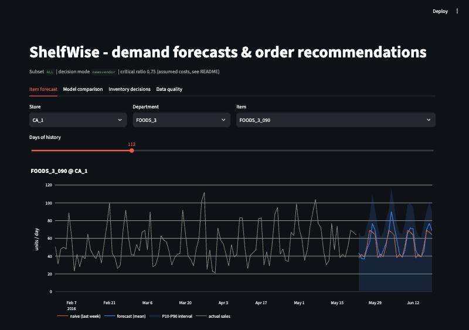
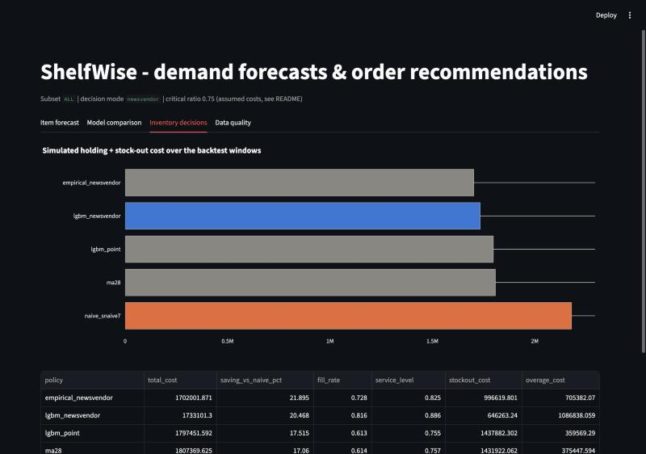
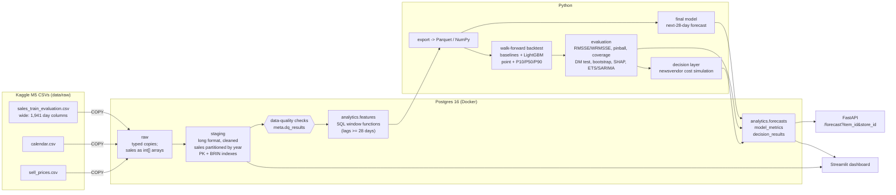
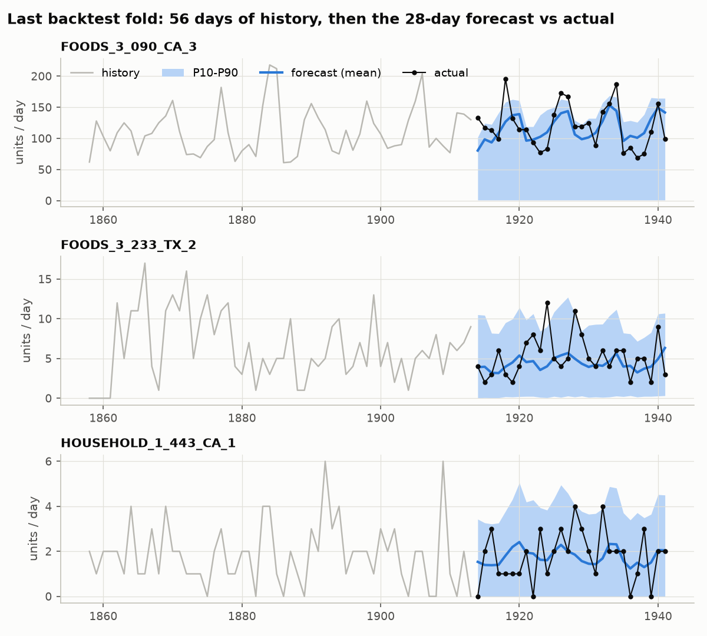
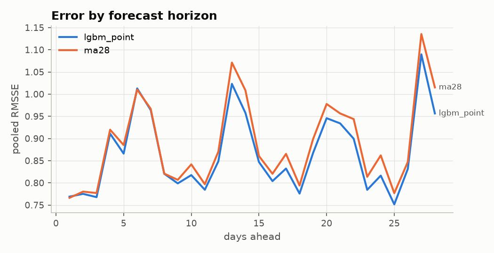

# ShelfWise

**Retail demand forecasting and inventory decisions on the Walmart M5 dataset.**

ShelfWise forecasts daily unit sales 28 days ahead for every product in every store
(30,490 item-store series, ~59M rows in long format), turns the forecasts into order
quantities with a newsvendor rule, and measures how much cost that saves compared with
naive ordering.

It is built as an end-to-end analytics system: a layered Postgres warehouse with SQL
feature engineering, data-quality checks, incremental loading, walk-forward
backtesting with significance tests, a decision layer, and a REST API plus a dashboard.

> **Headline (full M5 data, 3-fold walk-forward backtest):** WRMSSE 0.614 vs. 0.854 for
> the best baseline (−28%); store-level forecasts beat ETS and SARIMA. Item-level gains are
> small (−0.5% RMSSE, statistically significant). Newsvendor ordering cuts simulated cost
> by ~20% vs. naive ordering, but the LightGBM intervals are too wide, and a simple
> empirical-quantile policy is slightly cheaper. See [Results](#results).

---

<p align="center">
  
  
</p>

## Contents
- [Architecture](#architecture)
- [Repository layout](#repository-layout)
- [Setup and running](#setup-and-running)
- [Method in brief](#method-in-brief)
- [Results](#results)
- [Limitations](#limitations)
- [What I'd do next](#what-id-do-next)
- [Troubleshooting](#troubleshooting)

Detailed methodology, including design choices and the leakage argument: [docs/methodology.md](docs/methodology.md).

---

## Architecture



**Incremental by design.** Watermarks in `meta.watermarks` record how far each layer has
been built. A new batch of days is appended to staging, and only the affected feature
rows are recomputed, re-reading a fixed look-back buffer. A unit test checks that an
incremental build gives exactly the same rows as a full rebuild.

---

## Repository layout

```
├── config/config.yaml          methodology settings (windows, model params, cost assumptions)
├── .env.example                DB credentials, SUBSET, LAST_DAY (copy to .env)
├── docker-compose.yml          Postgres 16, tuned for a laptop analytics workload
├── Makefile                    every command (`make help`)
├── sql/
│   ├── ddl/                    schemas: raw, staging (partitioned), analytics, meta
│   ├── staging/                wide->long reshape (unnest WITH ORDINALITY), cleaning, indexes
│   └── analytics/features_select.sql   all feature engineering (window functions)
├── src/shelfwise/
│   ├── ingest/                 CSV -> raw (COPY, file fingerprinting)
│   ├── transform/              staging, features (incremental), export to Parquet
│   ├── quality/                data-quality checks + report
│   ├── forecasting/            folds, baselines, LightGBM, backtest, final forecast
│   ├── evaluation/             metrics, significance tests, error analysis, SHAP, ETS/SARIMA
│   ├── decision/               newsvendor rule + cost simulation
│   ├── serving/                FastAPI app, Streamlit dashboard, shared queries
│   ├── benchmark/              EXPLAIN ANALYZE before/after benchmark
│   └── pipeline/run.py         single entry point
├── tests/                      leakage (DuckDB), folds, ordering rule, metrics, DB integration
├── docs/methodology.md
└── reports/                    generated: results, figures, data-quality, benchmarks
```

---

## Setup and running

### Prerequisites
- Docker Desktop
- Python 3.11 or 3.12. Python 3.13 may work, but LightGBM and SHAP wheels are most reliable on 3.11/3.12.
- macOS only: `brew install libomp` (LightGBM needs OpenMP)
- About 10 GB free disk for the full dataset (Postgres plus caches); 16 GB RAM recommended for the full run

### Get the data (not committed)
Accept the competition rules on Kaggle, then download the files:
```bash
pip install kaggle
```
```bash
kaggle competitions download -c m5-forecasting-accuracy -p data/raw
```
```bash
unzip data/raw/m5-forecasting-accuracy.zip -d data/raw
```
You need `sales_train_evaluation.csv`, `calendar.csv` and `sell_prices.csv` in `data/raw/`.

### Run
```bash
make setup
```
```bash
make db-up
```
```bash
make run
```
`make run` executes `python -m shelfwise.pipeline.run`. The steps are:
init → load → staging → quality → features → export → backtest → evaluate → decide → forecast.
Each step's duration is logged to `reports/run_timings.csv`.

| Goal | Command |
|---|---|
| Fast development on one store | `make run-dev` (or set `SUBSET=CA_1` in `.env`) |
| One state / everything | `make run SUBSET=CA` / `make run SUBSET=ALL` |
| Demonstrate incremental loading | `make demo-incremental` (builds to d_1913, then appends 28 days) |
| Re-evaluate without retraining | `make evaluate` |
| Query benchmark | `make benchmark` |
| API / dashboard | `make api` (http://localhost:8000/docs), `make dashboard` (http://localhost:8501) |
| Tests | `make test` (no DB needed), `make test-integration` (after a run) |

Changing `SUBSET` triggers a full rebuild of staging and features automatically. The pipeline stores the subset next to each watermark and detects the change.

Example API call:
```bash
curl "http://localhost:8000/forecast?item_id=FOODS_3_090&store_id=CA_1&history_days=28"
```

---

## Method in brief

| Topic | Choice | Why |
|---|---|---|
| Features | Built in SQL with window functions: lags 28–56, rolling mean/std/zero-share ending 28 days back, days since last sale, price change / discount depth, events, SNAP | The database does the heavy lifting on 59M rows. Every sales-based feature ends **≥ 28 days before the target day**, so one model serves all 28 horizons without leakage. |
| Not-yet-on-sale days | Pre-launch zeros become NULL and are excluded | Those zeros are not zero demand. |
| Model | One **global** LightGBM: tweedie objective for the mean, plus quantile objectives for P10/P50/P90 | Global models learn shared patterns across sparse series (the approach that won M5). Tweedie fits zero-heavy counts. |
| Baselines | naive, seasonal naive (7/28), 28-day moving average, empirical quantiles | A model is only interesting if it beats these. |
| Validation | Walk-forward: 3 folds × 28 days, inner time-based early stopping | Random splits leak the future. |
| Metrics | RMSSE, WRMSSE (12 M5 levels), MASE, pinball loss, 80% interval coverage | Scale-free and robust to zeros. Plain RMSE/MAE/MAPE mislead (see below). |
| Significance | Diebold-Mariano (HAC), cluster bootstrap over items, Wilcoxon (with caveat) | Separates real gains from noise. |
| Classical comparison | ETS and SARIMA at total/state/store level vs. LightGBM bottom-up | Checks whether the model holds up where classical models are strongest. |
| Explainability | SHAP (TreeExplainer) on the last fold | Shows which features drive the forecasts. |
| Decision | Newsvendor: order the demand quantile at the critical ratio c_u/(c_u+c_o); simulate costs on the backtest windows; sensitivity over cost assumptions | Converts forecast quality into money, under stated assumptions. |

**Why not RMSE or "accuracy"?** Unscaled RMSE is dominated by a handful of fast movers.
MAPE is undefined when actual sales are 0, which is true for most item-days. MAE rewards
forecasting zero everywhere. The results tables include an all-`zeros` "model" to show
this trap explicitly. See `src/shelfwise/evaluation/metrics.py`.

---

## Results

**Run configuration:** all 30,490 series (subset `ALL`), 3 walk-forward folds of 28 days
(test windows d_1858–1885, d_1886–1913, d_1914–1941, i.e. 29 Feb–22 May 2016), ~20.8M training
rows per fold. Hardware: Apple Silicon laptop, 8 cores, 16 GB RAM.
All numbers come from `reports/results/` after `make run` on 2026-10-07. Nothing here is
estimated.

### Forecast accuracy (mean over folds, lower is better)

| Model | RMSSE | WRMSSE | MASE | Bias % |
|---|---|---|---|---|
| **LightGBM (tweedie, mean)** | **0.745** | **0.614** | 1.087 | −2.5 |
| Moving average (28d) | 0.748 | 1.077 | 1.073 | −1.5 |
| LightGBM P50 | 0.792 | 1.950 | 0.895 | −33.5 |
| Seasonal naive (7d) | 0.977 | 0.894 | 1.208 | −5.4 |
| Seasonal naive (28d) | 1.016 | 0.854 | 1.230 | −1.5 |
| Naive (last value) | 0.976 | 1.549 | 1.318 | +14.7 |
| *All zeros (MAE trap)* | 0.939 | 5.327 | 1.061 | −100 |

How to read this:
- **Where the money is, LightGBM is much better:** WRMSSE 0.614 vs. 0.854 for the best
  baseline (−28%). At the store level its summed forecasts beat ETS and SARIMA (table below).
- **Per individual item, the gain is small:** RMSSE 0.745 vs. 0.748 for a 28-day moving
  average (−0.5%). Most item-store series sell 0–2 units a day, and for those a moving
  average is already close to the best you can do.
- **P50 and the median-style baselines look good on MASE but are biased by −30%.** That is
  expected: the median of an intermittent series is near 0. It's also why the mean
  (tweedie) model is the one used for aggregation.

### Is the improvement real?
_Source: `reports/results/significance_tests.json`._
- Mean RMSSE: 0.7484 (moving average) → 0.7446 (LightGBM), a **0.5%** improvement.
- Diebold-Mariano test on 84 daily losses (HAC lag 7): one-sided **p = 5×10⁻⁶**.
- Cluster bootstrap over 3,049 items: RMSSE gain 0.0038, **95% CI [0.0026, 0.0051]**.
- LightGBM wins on 57.1% of series-folds.

Conclusion: the item-level improvement is statistically real but practically small. The
large, meaningful gains are at aggregate levels.

### Prediction intervals (nominal 80%)

| Model | Coverage P10–P90 | Below P10 | Above P90 | Scaled pinball | Mean width |
|---|---|---|---|---|---|
| LightGBM quantile | 0.885 | 0.009 | 0.106 | **0.306** | 3.09 |
| Empirical-quantile baseline | 0.902 | 0.011 | 0.087 | 0.315 | 2.72 |

LightGBM has the better quantile loss (DM p = 4×10⁻⁶), but **the intervals are too wide.**
Only 0.9% of actuals fall below P10 instead of 10%, because P10 is usually 0 for count data.

### Aggregate level vs. classical models (mean RMSSE)

| Level | LightGBM bottom-up | SARIMA | ETS | Seasonal naive 7d |
|---|---|---|---|---|
| Total | **0.407** | 0.541 | 0.590 | 0.692 |
| State (mean of 3) | **0.472** | 0.629 | 0.666 | 0.763 |
| Store (mean of 10) | **0.561** | 0.688 | 0.707 | 0.816 |

### Inventory decision (assumed costs: margin 30%, overage 10% of price → critical ratio 0.75)
_Source: `reports/results/decision.md`. Simulated costs over the 3 test windows._

| Policy | Total cost | Saving vs. naive | Fill rate | Service level |
|---|---|---|---|---|
| Empirical-quantile newsvendor | $1.70M | **21.9%** | 0.728 | 0.825 |
| LightGBM newsvendor (quantiles) | $1.73M | 20.5% (95% CI 19.7–21.2%) | 0.816 | 0.886 |
| LightGBM point forecast | $1.80M | 17.5% | 0.613 | 0.755 |
| Moving average (28d) | $1.81M | 17.1% | 0.614 | 0.757 |
| Naive (seasonal naive 7d) | $2.18M | 0% | 0.535 | 0.726 |

The honest reading:
- **Turning forecasts into a newsvendor rule saves 20–22% against naive ordering,** whichever forecast feeds it.
- **Using the quantiles instead of LightGBM's mean forecast saves another 3.6%** (CI 2.8–4.3%).
- **The LightGBM quantile policy is 1.8% more expensive than the simple empirical-quantile newsvendor at this cost assumption** (CI 1.1–2.6%). Its intervals are too wide, so it over-orders: 89% of days without a stock-out against a 75% target.
- In the sensitivity sweep (`decision.md`), LightGBM wins at critical ratios 0.5, 0.6 and 0.8–0.9, and loses at 0.7–0.75.
- Fixing calibration is the clearest next step. It has *not* been tuned on these test windows, to avoid tuning on the test set.

> **Disclosed post-hoc change:** quantile orders are rounded to the **nearest** unit. The
> first backtest (store CA_1) rounded **up**, the textbook discrete newsvendor rule. That
> over-ordered slow movers whose estimated P75 was a fraction like 0.3, and made the
> policy 4.7% *more* expensive than ordering the mean forecast; rounding to the nearest
> unit made it 6.0% cheaper. Because the change was made after seeing test results, it is
> disclosed here, and `decision.rounding: up` reproduces the original numbers. No further
> changes were made after the full-data run. Details:
> [docs/methodology.md §6](docs/methodology.md#6-decision-layer).

### Where the model wins and fails
_Pooled RMSSE, LightGBM vs. the moving-average baseline (`reports/results/error_by_segment.csv`)._
- **Biggest gains:** long horizons (22–28 days ahead: −4.2%, vs. −0.6% at 1–7 days) and
  HOUSEHOLD items (−4.2%). The model's level and seasonality features hold up when a flat
  average goes stale.
- **Promotions are the weak spot:** on price-discount days the error is highest (1.08) and
  the forecast is **20% too low**. M5 has no promotion flag, and the discount proxy only
  partly captures uplift.
- **Intermittent series** make up 76% of rows, and the gain there is only 1.2%.
- **Top drivers (SHAP):** 56- and 28-day rolling means, item, department, day of week,
  store, and days since last sale.

### Pipeline and data
- 59.2M long-format rows in staging; 25.7M feature rows built in SQL in 5.0 min.
- 18 data-quality checks. All ERROR-level checks pass. Two warnings: 1,149 week-over-week price jumps above 3×, and 447 prices more than 5× away from the item median.
- An incremental 28-day load produces a feature table **identical** (checksum) to a full rebuild.
- Step timings (full data):

  | staging | quality | features | export | backtest | evaluate | decide | final forecast |
  |---|---|---|---|---|---|---|---|
  | 2.8 min | 4.7 min | 5.0 min | 2.6 min | 100.8 min | 1.2 min | 0.4 min | 58.0 min |

### Query performance (EXPLAIN ANALYZE, median of 5 warm runs)
_Source: `reports/benchmarks/benchmark_results.md`. 59.2M rows; "before" = the same rows in one
unpartitioned table with no indexes._

| Query | Before | After | Speed-up |
|---|---|---|---|
| One item's last 365 days (API pattern) | 2,052 ms | 0.08 ms | ~25,000× (index scan instead of a full table scan) |
| All series on one day | 1,930 ms | 17.6 ms | 110× (1 of 7 partitions scanned) |
| Store totals, last 28 days | 2,086 ms | 128.6 ms / **0.32 ms** with the materialized view | 16× / 6,600× |
| 7-day rolling mean, last 90 days | 6,672 ms | 1,768 ms | 3.8× |
| Monthly revenue by department, last year | 28,041 ms | 13,555 ms | 2.1× (high run-to-run variance) |

Caveat on fairness: the unindexed table (3.0 GB) is larger than Postgres's 1 GB buffer cache,
so every "before" run reads ~360k blocks from disk/OS cache, while the smaller pruned "after"
scans stay cached. That is part of the real benefit of pruning and indexing, but it inflates
the ratios for the full-scan queries. The single-item lookup speed-up is structural (index vs.
full scan) either way. The optimised layout costs storage: 4.3 GB (including 1.3 GB of
indexes) vs. 3.0 GB.

### Figures



The P10 edge of the band sits near zero even for FOODS_3_090 at 100+ units a day. This is the calibration problem described above.



After a run, `reports/figures/` also contains `model_comparison_rmsse.png`, `forecast_examples.png`,
`error_by_horizon.png`, `error_by_segment.png`, `shap_importance.png`, `decision_costs.png`
and `decision_sensitivity.png`.

## Limitations

- **Sales are not demand.** M5 records sales. On days an item was out of stock, true demand was higher (censored demand). Forecasts learn the censored pattern, and the cost simulation undercounts stock-outs. Long zero streaks are flagged by the data-quality step but cannot be fixed with this data.
- **Cost assumptions are invented.** M5 has no costs, margins, lead times or inventory. The decision results depend on the assumed margin and holding cost. The sensitivity analysis shows how the conclusion changes as these vary; treat the dollar figures as illustrative.
- **Simplified inventory model.** The default newsvendor mode is single-period with no carry-over. The carry-over mode assumes zero lead time and daily review. Real replenishment has lead times, case packs, minimum orders and shelf capacity.
- **Promotions are inferred.** M5 has no promotion flag, so "discount" means a price at least 5% below the 8-week maximum.
- **Prices are assumed known in advance** for the forecast window. This is standard for M5 and reasonable for a retailer's own prices.
- **The P10 model barely leaves zero.** The quantile models stop early (P10 after about 90–130 rounds), likely because the pinball loss is dominated by the many zero-sales rows. P10 therefore stays near 0 even for fast movers.
- **Quantile forecasts are not well calibrated.** On the full data, intervals are too wide (88.5% coverage vs. 80% nominal; only 0.9% of actuals fall below P10). As a result, the P75-based orders avoid stock-outs on 89% of days against a 75% target, and the policy loses narrowly to a simple empirical-quantile rule. Rounding a continuous quantile estimate to whole units is also an approximation; see the disclosed change above.
- **Quantiles beyond P10–P90 are interpolated or clamped,** and the newsvendor uses daily quantiles. Quantiles of multi-day totals would need a joint model, because quantiles do not add.
- **Only a few folds.** Three 28-day windows from 2016 can't cover all seasons (for example, Christmas). The tests are honest about that small sample.
- **One global horizon treatment.** Using lags of at least 28 days for every horizon is safe but wastes recent information for short horizons.
- **Incremental loads don't detect restatements** of old days; use `FULL_REFRESH=1`.

## What I'd do next

1. **Horizon-specific models** (for example, days 1–7 with lag 7+) or recursive features, so short horizons use recent data.
2. **Stock-out–aware demand:** detect likely stock-out runs and treat them as missing, or use a censored-demand model.
3. **Joint or probabilistic models of multi-day demand** (sample paths), so order quantities for a review period use the right distribution, plus lead times and case-pack constraints in the simulation.
4. **Hierarchical reconciliation** (MinT) so item, store and total forecasts are coherent.
5. **Calibrate the quantiles** (conformal prediction, or per-segment recalibration). Fit it on an extra validation window *before* the test folds, so the decision results are not tuned on the test set. This is the most direct fix for the over-ordering found in the backtest.
6. **Hyperparameter tuning** with Optuna on the inner validation windows, and per-store or per-department models.
7. **Orchestration and monitoring:** run the steps as an Airflow/Dagster DAG, add drift and data-freshness alerts, store models in MLflow, and containerise the API and dashboard.

## Troubleshooting

| Symptom | Fix |
|---|---|
| `Cannot connect to Postgres` | `make db-up`; check `POSTGRES_PORT` isn't used by a local Postgres |
| `role "shelfwise" does not exist` | Another Postgres (e.g. Homebrew) owns port 5432: set `POSTGRES_PORT=5433` in `.env`, then `make db-up` |
| `docker-credential-desktop: executable file not found` | `export PATH="/Applications/Docker.app/Contents/Resources/bin:$PATH"` before `make db-up` |
| `could not resize shared memory segment` | Already handled by `shm_size: 1gb` in `docker-compose.yml`; restart the container |
| LightGBM `Library not loaded: libomp.dylib` | `brew install libomp` |
| Out of memory in backtest (full data) | Set `lgbm.max_train_rows: 8000000` and/or reduce `lgbm.train_window_days` in `config/config.yaml` |
| `Data-quality ERROR checks failed` | Read `reports/data_quality/latest.md`. The listed rows show what's wrong. |
| `staging holds subset X but SUBSET=Y` | Run the staging step first (`make run` does this) |
